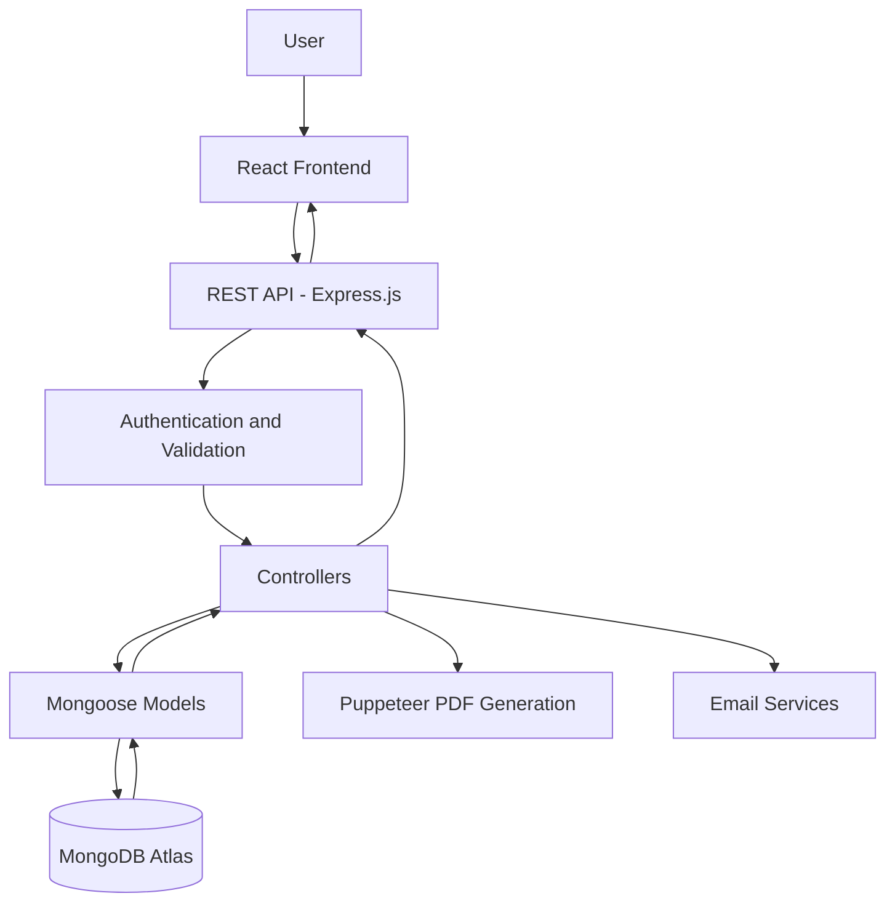

# Chronicle.

<p align="center">
  
</p>
<p align="center">
  A personal journaling application built for writing, reflecting, and preserving the moments that matter.
</p>

<p align="center">
  <a href="https://chronicle-jet-ten.vercel.app/">
    
  </a>
  <a href="https://github.com/Shivang0402/Chronicle">
    
  </a>
</p>

<p align="center">
  
  
  
  
  
</p>

---

## About Chronicle

Chronicle is a personal digital journaling application designed to give your thoughts, experiences, and reflections a place of their own.

Not everything needs to be shared. Not every thought needs an audience.

In a digital world dominated by social feeds, notifications, and constant interaction, Chronicle takes a different approach. It provides a dedicated space where you can write freely, organize your experiences, revisit old memories, and understand your journaling habits.

From a passing thought to a detailed account of an important day, Chronicle makes it easier to document the things that make up your story.

**It isn't about creating more content. It's about preserving more meaning.**

## Why Chronicle?

Most digital platforms are designed around sharing and interaction. Traditional note-taking applications, on the other hand, often lack the personal experience and reflection that make journaling meaningful.

Chronicle was built around a different philosophy:

- **A personal space:** Your journal belongs to you, without the pressure of sharing.
- **Freedom to write:** A dedicated environment for long-form writing and personal expression.
- **Meaningful organization:** Keep your memories organized through dates, moods, and tags.
- **Reflection through insights:** Understand your writing habits and explore patterns over time.
- **Preserving memories:** Keep your journal accessible and exportable.

The goal is to make journaling a natural part of everyday life, rather than another task to complete.

---

## Features

<table>
  <tr>
    <td width="50%">
      <h3>Personal Journaling</h3>
      Create, edit, and revisit journal entries with support for long-form writing.
    </td>
    <td width="50%">
      <h3>Search and Organization</h3>
      Find entries using search, filters, sorting, dates, moods, and tags.
    </td>
  </tr>
  <tr>
    <td width="50%">
      <h3>Journaling Insights</h3>
      Explore monthly activity, mood distribution, and personal writing statistics.
    </td>
    <td width="50%">
      <h3>PDF Export</h3>
      Generate formatted PDF exports to preserve journal entries outside the application.
    </td>
  </tr>
  <tr>
    <td width="50%">
      <h3>Authentication</h3>
      Account registration, email verification, secure password hashing, and protected API endpoints.
    </td>
    <td width="50%">
      <h3>Responsive Interface</h3>
      A React-based interface with thoughtful interactions and responsive layouts.
    </td>
  </tr>
</table>

---

## Technology Stack

Chronicle is built using the MERN ecosystem, with additional tools for frontend development, authentication, document generation, testing, and deployment.

### Frontend

<p align="center">
  
</p>

<p align="center">
  React.js &nbsp; | &nbsp; React Router &nbsp; | &nbsp; Vite &nbsp; | &nbsp; Tailwind CSS &nbsp; | &nbsp; Framer Motion
</p>

### Backend and Database

<p align="center">
  
</p>

<p align="center">
  Node.js &nbsp; | &nbsp; Express.js &nbsp; | &nbsp; MongoDB &nbsp; | &nbsp; Mongoose
</p>

### Development and Infrastructure

<p align="center">
  
</p>

<p align="center">
  Docker &nbsp; | &nbsp; Git &nbsp; | &nbsp; GitHub &nbsp; | &nbsp; Postman
</p>

### Technology Breakdown

| Category | Technologies |
|---|---|
| Frontend | React.js, React Router, Vite |
| Styling and Animation | Tailwind CSS, Framer Motion |
| Backend | Node.js, Express.js |
| Database | MongoDB, Mongoose |
| Authentication | JSON Web Tokens, bcrypt |
| Email Services | SMTP, Nodemailer |
| PDF Generation | Puppeteer, Chromium |
| API Testing | Postman |
| Testing | Node.js test runner |
| Containerization | Docker, Docker Compose |
| Deployment | Vercel, Render, MongoDB Atlas |

---

## Application Architecture

Chronicle follows a client-server architecture in which the frontend communicates with the backend through RESTful APIs.

The backend handles authentication, request validation, application logic, and database operations.



### How It Works

**Authentication**

- Users register using their account details.
- Passwords are hashed using bcrypt.
- Email verification is supported.
- JWTs are issued after successful authentication.
- Protected routes validate authentication before allowing access to user-specific resources.

**Journal Management**

- Users create and manage their journal entries.
- Each entry is associated with its respective user.
- Mongoose handles database interactions.
- Search, filtering, sorting, and pagination help retrieve entries efficiently.

**Insights and Analytics**

- Journal data is processed through backend aggregation and query logic.
- Monthly activity and mood statistics are generated.
- The frontend presents the resulting insights.

**PDF Generation**

- Journal content is processed by the backend.
- Puppeteer uses headless Chromium to generate formatted PDF documents.
- Users can preserve their written entries outside the application.

---

## Project Structure

```text
Chronicle/
│
├── frontend/
│   ├── public/
│   ├── src/
│   │   ├── components/
│   │   ├── pages/
│   │   ├── context/
│   │   └── ...
│   ├── .env.example
│   ├── vercel.json
│   └── package.json
│
├── src/
│   ├── config/
│   ├── controllers/
│   ├── middlewares/
│   ├── models/
│   ├── routes/
│   ├── templates/
│   └── utils/
│
├── tests/
├── postman/
├── .postman/
│
├── Dockerfile
├── docker-compose.yml
├── render.yaml
├── package.json
├── package-lock.json
└── README.md
```

---

## Getting Started

Want to explore the project locally? Follow these steps.

### Prerequisites

Make sure you have:

- Node.js 22+
- npm
- MongoDB Atlas account or a local MongoDB instance
- Git

### 1. Clone the Repository

```bash
git clone https://github.com/Shivang0402/Chronicle.git

cd Chronicle
```

### 2. Configure the Backend

Install backend dependencies:

```bash
npm ci
```

Create your environment file:

```bash
cp .env.example .env
```

Configure the required environment variables:

```env
PORT=4444
MONGO_URI=your_mongodb_connection_string
JWT=your_jwt_secret
CLIENT_URL=http://localhost:5173
```

Additional SMTP configuration can be added for email delivery.

### 3. Start the Backend

```bash
npm run dev
```

The API will be available at:

`http://localhost:4444`

### 4. Configure the Frontend

Open another terminal:

```bash
cd frontend

npm ci
```

Create the frontend environment file:

```bash
cp .env.example .env
```

Configure the API URL if required by your frontend configuration:

```env
VITE_API_URL=http://localhost:4444
```

### 5. Start the Frontend

```bash
npm run dev
```

Open the application at:

`http://localhost:5173`

### Running with Docker

Chronicle also includes Docker and Docker Compose configurations.

To start the application stack:

```bash
docker compose up --build
```

To stop the containers:

```bash
docker compose down
```

---

## API Overview

All API endpoints use the `/api` prefix.

| Method | Endpoint | Description |
|---|---|---|
| POST | `/api/auth/register` | Register a new user |
| POST | `/api/auth/login` | Authenticate a user |
| GET | `/api/auth/verify-email` | Verify email address |
| POST | `/api/auth/forgot-password` | Request password reset |
| POST | `/api/auth/reset-password` | Reset password |
| PATCH | `/api/auth/change-password` | Change password |
| GET | `/api/auth/profile` | Retrieve user profile |
| GET | `/api/chronicle/getchronicles` | Retrieve journal entries |
| POST | `/api/chronicle` | Create journal entry |
| GET | `/api/chronicle/:id` | Retrieve an individual entry |
| PATCH | `/api/chronicle/:id` | Update an entry |
| DELETE | `/api/chronicle/:id` | Delete an entry |
| GET | `/api/chronicle/search` | Search journal entries |
| GET | `/api/chronicle/stats` | Retrieve journaling statistics |
| GET | `/api/chronicle/moods` | Retrieve mood information |
| GET | `/api/chronicle/tags` | Retrieve tags |
| GET | `/api/chronicle/export` | Export journal entries |

Protected endpoints require a valid JWT in the Authorization header:

```http
Authorization: Bearer <your_token>
```

---

## Deployment

Chronicle uses separate hosting services for its frontend and backend.

<p align="center">
  
</p>

| Component | Platform |
|---|---|
| Frontend | Vercel |
| Backend | Render |
| Database | MongoDB Atlas |

The frontend communicates with the deployed API using the `VITE_API_URL` environment variable.

Sensitive configuration, including database credentials, JWT secrets, and SMTP credentials, is maintained through environment variables rather than committed to source control.

---

## Security and Privacy

Chronicle is designed as a personal journaling platform, so protecting user data is an important part of its architecture.

The application incorporates:

- Password hashing using bcrypt.
- JWT-based authentication.
- Protected API routes.
- User-specific journal data access.
- Environment-based configuration.
- Database access restrictions.

**Privacy is an important design goal, but the current application does not claim end-to-end encryption.** Stored journal content may be accessible to authorized backend and database operators.

---

## Future Scope

Chronicle is an evolving project. Some areas that could be explored further include:

- End-to-end encryption for journal entries.
- Advanced writing and formatting capabilities.
- Image attachments within entries.
- More detailed writing analytics.
- Complete diary backup and export.
- Additional personalization and customization.

---

## Author

**Shivang Pandey**

<p align="center">
  <a href="https://github.com/Shivang0402">
    
  </a>
</p>

---

<p align="center">
  
  <br/>
  <strong>Chronicle.</strong>
  <br/>
  <a href="https://chronicle-jet-ten.vercel.app/">Explore the application</a>
  <br/><br/>
  <sub>Built with care, one entry at a time.</sub>
</p>
